<picture>
  <source media="(max-width: 600px)" srcset="./assets/hero-compact.svg">
  
</picture>

<p align="center">
  <a href="#user-content-selected-work">精选项目</a> &nbsp; / &nbsp;
  <a href="#user-content-engineering">技术与实践</a> &nbsp; / &nbsp;
  <a href="#user-content-exploration">探索记录</a> &nbsp; / &nbsp;
  <a href="https://github.com/Samuel521199?tab=repositories">全部公开仓库 ↗</a>
</p>

我关注 **个人 AI 助手、智能工作流与游戏创作工具**。从模型接入、记忆和任务编排，到桌面界面、可视化编辑与游戏交互，把想法逐步落到可以阅读、运行和继续迭代的代码里。

**当前重心 → [JarvisSystem](https://github.com/Samuel521199/JarvisSystem)**：围绕自然交流、个人记忆和持续协助，构建由使用者掌控的个人 AI 助手。

<a id="selected-work"></a>
## Selected work / 项目现场

<a href="https://github.com/Samuel521199/JarvisSystem">
  
</a>

**长期相处的助手，也是一套可持续演进的个人工作台。**

公开仓库包含聊天与模型路由、个人记忆、项目文件工作区、技能与 MCP，以及语音和受限成长能力的代码与文档。开发原型的实现、验证和待完成范围分别记录，具体状态以仓库证据为准。

[源码](https://github.com/Samuel521199/JarvisSystem) · [架构与文档](https://github.com/Samuel521199/JarvisSystem/blob/main/docs/README.md) · [验证记录](https://github.com/Samuel521199/JarvisSystem/blob/main/docs/delivery-validation.md)

<p>
  <a href="https://github.com/Samuel521199/StructForge"></a>
  <a href="https://github.com/Samuel521199/word-front"></a>
</p>

**[StructForge](https://github.com/Samuel521199/StructForge)**

可视化 AI 工作流编排。公开代码按 Vue 前端和 Go 后端组织，围绕模型接入、节点和工作流执行展开。早期相关仓库：[StructForgeAI](https://github.com/Samuel521199/StructForgeAI)。

**[词锋 · WORD FRONT](https://github.com/Samuel521199/word-front)**

将英语词汇学习与二战题材战术卡牌结合，包含内容工坊、FSRS 复习调度及 Web / Windows 桌面代码。当前公开说明为本地可玩版本；从源码启动需要另行取得匹配的内容密钥，运行条件见仓库说明。

### More systems / 继续探索

| 项目 | 方向与公开内容 | 技术线索 |
| :--- | :--- | :--- |
| **[RenYiMen](https://github.com/Samuel521199/RenYiMen)** | AI 工作流前端，将 ComfyUI / RunningHub 工作流输入映射成 Schema 驱动界面；运行依赖后端网关。 | Next.js · TypeScript · Zustand |
| **[Jachin System](https://github.com/Samuel521199/jachin-system)** | 分布式 AI 助手架构探索，包含控制面、桌面客户端和插件 SDK。 | Python · Tauri · Rust |
| **[Boaz](https://github.com/Samuel521199/Boaz)** | 主机环境审计与威胁检测方向，公开 Rust 工程和桌面界面代码。 | Rust |
| **[BEZALEL](https://github.com/Samuel521199/BEZALEL)** | 自动化软件工程实验，将规划、编码角色与编排器组合成工作流。 | Python · LangGraph |
| **[BoneFX](https://github.com/Samuel521199/BoneFX)** | 2D / 伪 3D 动画工具探索，围绕渲染、动画、编辑器与模型接口组织。 | TypeScript |

<a id="engineering"></a>
## Engineering / 从代码到系统

| 关注层 | 公开项目中的实践 |
| :--- | :--- |
| **AI & agents** | 个人记忆、模型接入、技能与工具调用、任务编排；见 JarvisSystem、Jachin、BEZALEL。 |
| **Workflow & interfaces** | 可视化节点、Schema 驱动表单、Web 与桌面界面；见 StructForge、RenYiMen。 |
| **Games & creative tools** | 战术卡牌、间隔复习、动画与渲染工具；见 Word Front、BoneFX。 |
| **System foundations** | Python 服务、Go 后端、Rust 模块，配合项目文档、配置与验证记录。 |

```text
DEFINE THE PROBLEM
    └── design the system
            └── build the smallest useful version
                    └── inspect, test, iterate
```

<a id="exploration"></a>
## Field notes / 探索记录

公开仓库是开发过程的记录。这里按主题整理作品，不把目标描述当作已经完成的能力。

<details>
<summary><strong>早期实验与其他公开仓库</strong></summary>

- [NebulaVerseAI](https://github.com/Samuel521199/NebulaVerseAI)、[DesignerEditor](https://github.com/Samuel521199/DesignerEditor)、[VisualAnalysisSystem](https://github.com/Samuel521199/VisualAnalysisSystem)：早期 Python 实验。
- [kratos_server](https://github.com/Samuel521199/kratos_server)：基于 Kratos 布局的 Go 微服务示例。
- [test2](https://github.com/Samuel521199/test2)：实验仓库。
- [AIUnityMCP](https://github.com/Samuel521199/AIUnityMCP)、[UnityMindFlowPro](https://github.com/Samuel521199/UnityMindFlowPro)：核对时尚无代码内容，保留为探索记录。

</details>

<details>
<summary><strong>Fork / 关注与学习的上游项目</strong></summary>

以下为 Fork，不计入个人作品；项目与贡献归属以各自上游及提交记录为准。

- **记忆与文档**：[mem0](https://github.com/Samuel521199/mem0)、[openwiki](https://github.com/Samuel521199/openwiki)。
- **语音与陪伴**：[voicebox](https://github.com/Samuel521199/voicebox)、[VoxCPM](https://github.com/Samuel521199/VoxCPM)、[airi](https://github.com/Samuel521199/airi)。
- **工具与交互**：[OmniParser](https://github.com/Samuel521199/OmniParser)、[grok-build-fork](https://github.com/Samuel521199/grok-build-fork)、[clickyfork](https://github.com/Samuel521199/clickyfork)、[scroll-world](https://github.com/Samuel521199/scroll-world)。

</details>

<br>


<p align="center">
  <a href="https://github.com/Samuel521199?tab=repositories">浏览项目</a> ·
  <a href="https://github.com/Samuel521199/JarvisSystem/issues">围绕 Jarvis 交流</a>
</p>

<sub>项目资料核对：2026-10-20，来源为公开 GitHub 仓库、README 与目录。介绍不替代各项目的运行或验收结果。视觉资源随本仓库维护，不依赖第三方统计卡片服务。</sub>
